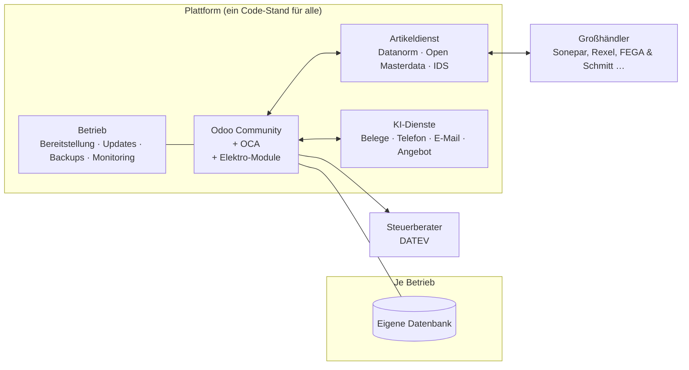

# Vision: Branchen-ERP als Komplettservice – Beispiel Elektrohandwerk

Stand: 25.10.2026 · Status: Konzeptentwurf zur Diskussion

## 1. Die Idee

Ein ERP als Software-Abo (SaaS) für **eine** klar definierte Sparte, zuerst das
Elektrohandwerk. Das Geschäftsmodell der Sparte ist darin als Standard
vorkonfiguriert:

- Großhandelsanbindung und Artikeldaten sind von Anfang an da.
- Dazu kommen Module für Kundenbesuch, Aufmaß und Angebot.
- KI-Dienste übernehmen Belegerfassung, Telefon und E-Mail.
- Ein Serviceteam kümmert sich um Einrichtung, Pflege, Hosting, Website und
  Support.

Der Betrieb kauft keine Software, sondern **eine funktionierende Büro- und
Prozessabteilung**.

## 2. Bewertung in Kürze

**Was für die Idee spricht**

- **Echter Bedarf.** Kleine Betriebe sind mit ERP, Buchhaltung, Website und
  Erreichbarkeit überfordert. Das Problem ist weniger fehlende Software als
  fehlende Zeit und fehlendes Know-how. Ein Serviceangebot trifft das besser
  als ein weiteres Programm.
- **Standardisierung ist der richtige Hebel.** Ein Standard für alle Betriebe
  einer Sparte bedeutet: ein Code-Stand, eine Migration pro Jahr für alle
  Kunden, wiederverwendbare Schulung und Vorlagen. Erst das macht SaaS
  wirtschaftlich.
- **Der Zeitpunkt passt.**
  - Ab 2027 (Umsatz über 800.000 €) bzw. 2028 (alle) müssen B2B-Rechnungen
    elektronisch sein.
  - Seit 2025 müssen alle Betriebe E-Rechnungen empfangen können.
  - KI-Belegerfassung und Sprachassistenten sind erst seit kurzem gut genug
    und bezahlbar.
- **Odoo Community taugt als Kern.** Verkauf, Einkauf, Lager, Projekte,
  Rechnung, XRechnung/ZUGFeRD und Kundenportal sind frei vorhanden (siehe
  [01-odoo-community-module.md](01-odoo-community-module.md)). Die LGPL-3
  erlaubt den Betrieb als SaaS.

**Was kritisch ist**

- **Der Markt ist voll.**
  - Es gibt etablierte Handwerkersoftware, z. B. Taifun/TopKontor, KWP,
    Label, Streit, M-Soft, HERO, plancraft, Das Programm, ToolTime, mfr.
  - Einige davon bieten schon KI-Telefonassistenz und KI-Arbeitsberichte.
  - Odoo selbst hat ein offizielles Branchenpaket „Electricians“ (Abschnitt 3).
- **Die ERP-Funktionen allein differenzieren nicht.** Differenzieren können
  nur drei Dinge: der Service, die tiefe Verzahnung der KI mit den ERP-Daten
  und die Großhandelsanbindung.
- **Der Service ist personalintensiv.** Support, Einrichtung und
  Buchhaltungsvorbereitung skalieren nicht wie Software. Die Marge hängt
  daran, wie viel davon automatisiert wird.
- **Es gibt rechtliche Grenzen.**
  - Buchhaltung als Dienstleistung begrenzt das Steuerberatungsgesetz.
  - Für Telefon-KI gelten der AI Act und das Datenschutzrecht.
  - Für das SaaS-Modell sind die AGPL-Lizenzen vieler OCA-Module relevant.
- **Vertrieb ins Handwerk ist teuer und langsam.** Handwerker kaufen auf
  Empfehlung, über Innung, Großhändler oder Kollegen, selten online.

**Gesamturteil:** Die Vision ist schlüssig und mit Odoo Community als Kern
technisch machbar. Über den Erfolg entscheidet nicht die Software, sondern
zweierlei: ob Betriebe für den **Service** zahlen, und ob ein **Vertriebskanal**
gefunden wird, idealerweise über einen Großhändler oder eine
Einkaufsgenossenschaft. Beides sollte geprüft werden, bevor viel Code
entsteht.

## 3. Markt und Wettbewerb

### Zielgruppe Elektrohandwerk (Deutschland)

| Kennzahl | Wert | Quelle |
|---|---|---|
| Betriebe | 48.225 (2023); 2025 leicht gestiegen (+0,5 %) | Deutsche Handwerks Zeitung, Handwerksblatt |
| Umsatz | rund 88,2 Mrd. € (2025) | Handwerksblatt (Destatis) |
| Sozialversicherungspflichtig Beschäftigte | 451.050 (2025) | Handwerksblatt |

Das sind im Schnitt rund 10 Beschäftigte je Betrieb, also überwiegend kleine
Betriebe ohne eigene IT oder Verwaltung.

### Wettbewerb

| Kategorie | Beispiele | Stärke | Lücke für dieses Konzept |
|---|---|---|---|
| Klassische Handwerkersoftware | Taifun/TopKontor, KWP, Label, Streit V.1, M-Soft | Tiefe Branchenfunktionen, Datanorm/IDS, große Kundenbasis | Oft Desktop-lastig, wenig Service, KI nur punktuell |
| Cloud-Handwerkersoftware | HERO, plancraft, Das Programm, ToolTime, mfr | Mobil, modern, teils mit KI-Telefon | Software, kein Komplettservice; kein vollwertiges ERP |
| Odoo-Branchenpaket „Electricians“ | Odoo S.A. (offiziell) | Breites ERP, Marke | Nur Enterprise (OEEL-1, setzt Field Service, Planning, Studio u. a. voraus); laut Odoo reine Standardkonfiguration ohne Anpassungen, also ohne deutsche Großhandelsschnittstellen |
| Einzel-KI-Dienste | KI-Telefonassistenten (z. B. Famulor, ElevenLabs) | Schnell startklar, günstig | Nicht mit Aufträgen, Kunden und Einsatzplanung verbunden |

### Preisniveau (Orientierung)

| Anbieter | Preis laut Quelle (2026) |
|---|---|
| HERO | ab 59–69 €/Monat (Einstieg), HERO OS ab 119–135 €/Monat, OS Plus ab 299–345 €/Monat |
| plancraft | ca. 60–75 € je Nutzer/Monat |
| KI-Telefonassistent (Famulor) | ab 49 €/Monat (Anbieterangabe) |

**Hypothese zur Prüfung:** Ein Komplettpaket aus Software, KI-Diensten und
Service ist bei etwa 200–400 € pro Betrieb und Monat vermittelbar, wenn es
nachweislich Bürozeit spart. Diese Zahl muss in Gesprächen mit Betrieben
validiert werden.

## 4. Fachliche Bausteine: der „Elektro-Standard“

| Baustein | Basis in Odoo Community / OCA | Eigenentwicklung |
|---|---|---|
| Kunden, Objekte, Anlagen | `contacts`, `crm`, `maintenance` | Objekt-/Anlagenstruktur (Gebäude, Verteiler, Stromkreise) |
| Kundenbesuch, Aufmaß | `calendar`, `project` | Mobile Aufmaßerfassung mit Fotos und Sprachnotizen |
| Kalkulation und Angebot | `sale_management`, Preislisten | Kalkulation Material + Lohnminuten + Zuschläge, Positions-/LV-Struktur, GAEB-Import für Ausschreibungen |
| Auftrag, Einsatzplanung | `project`, OCA `fieldservice` (39 Module für 18.0, AGPL-3) | Disposition, Notdienst |
| Stundenzettel, Regiebericht | `hr_timesheet` | Mobile Erfassung mit Kundenunterschrift |
| Material, Fahrzeuglager | `stock`, `purchase` | Fahrzeug als Lagerort, Nachschub aus Großhandel |
| Abschlags-/Schlussrechnung | `account`, `sale` (Anzahlungen) | Abschlagsrechnung nach Baufortschritt (VOB) |
| Wartungsverträge, wiederkehrende Prüfungen | `maintenance` | **DGUV V3 / E-Check**: Prüffristen, Import aus Messgeräten (z. B. Gossen Metrawatt Secutest, Benning, Fluke via CSV/XML), Protokoll nach ZVEH-Vorlage |
| E-Rechnung | `account_edi_ubl_cii` (XRechnung, ZUGFeRD) | – |
| Übergabe an Steuerberater | OCA `datev_export_dtvf` | – |
| Kundenportal | `portal` | Angebote freigeben, Termine, Dokumente |

## 5. Großhandel und Artikeldaten

| Standard | Zweck | Bemerkung |
|---|---|---|
| **Datanorm** | Artikelstammdaten und Preise als Datei vom Großhändler | Weit verbreitet, gilt als veraltet |
| **Open Masterdata** | Stammdaten online abrufen (Nachfolger von Datanorm) | ITEK; Elektro-Pilot u. a. mit Sonepar, Rexel, FEGA & Schmitt, DEHA |
| **IDS-Connect** | Warenkorb zwischen Software und Großhändler-Shop, ab Version 2.5 mit Artikelsuche | Von Handwerkersoftware breit unterstützt |
| **UGL** | Weitere gebräuchliche Schnittstelle (Bestell-/Angebotsaustausch) | Details noch zu klären |
| **ETIM / BMEcat** | Klassifikation und Katalogformat der Hersteller | Grundlage für eine herstellerübergreifende Artikelbasis |
| **ELBRIDGE** | Hersteller-Konfigurator → Warenkorb des Großhändlers | Indirekt relevant (z. B. Hager, ABB) |

Für Odoo habe ich keine fertigen Module für Datanorm oder IDS-Connect gefunden.
Das ist Eigenentwicklung, aber auch ein Alleinstellungsmerkmal gegenüber dem
Odoo-Branchenpaket.

**Datenrechte beachten:** Artikelstammdaten und Preise gehören Herstellern und
Großhändlern. Eine zentrale Datenbank „aller Elektroartikel“ darf nicht einfach
aufgebaut und weitergegeben werden. Realistisch sind zwei Wege:

1. Jeder Betrieb verbindet seinen Großhändlerzugang. Die Plattform holt die
   Daten über Datanorm, Open Masterdata oder IDS mit den individuellen
   Konditionen.
2. Eine gemeinsame Basis aus Herstellerdaten (ETIM/BMEcat) mit entsprechenden
   Nutzungsvereinbarungen.

**Strategische Chance:** Großhändler wollen Handwerker an sich binden und
fördern teils schon eigene Software. Das zeigt etwa die FEGIME-Anbindung
„Großhändler Online“ der IN-Software. Eine Partnerschaft mit einem
Großhändler oder einer Einkaufsgenossenschaft könnte zugleich Datenzugang
**und** Vertriebskanal sein.

## 6. KI-Dienste

| Dienst | Was er tut | Verknüpfung mit dem ERP |
|---|---|---|
| **Belegerfassung** | Liest Eingangsrechnungen, Lieferscheine, Auftragsbestätigungen (PDF, Foto, E-Mail-Anhang, XRechnung) | Abgleich Bestellung ↔ Lieferschein ↔ Rechnung, Buchungsvorschlag, Wareneingang, Preisabweichungen melden |
| **Telefonassistent** | Nimmt Anrufe an, erkennt Notfälle, beantwortet Standardfragen | Kennt Kunden und offene Aufträge, bucht Termine direkt in die Einsatzplanung, legt Rückrufnotiz am Kunden an |
| **E-Mail-Assistent** | Sortiert Eingänge, schreibt Antwortentwürfe | Hängt E-Mails an Kunde/Auftrag, leitet Belege an die Belegerfassung, Entwurf mit Auftragsstatus |
| **Angebotsassistent** | Macht aus Aufmaß, Fotos und Sprachnotizen einen Angebotsentwurf | Artikel und Preise aus den Großhandelsdaten, Lohnzeiten aus Erfahrungswerten |

Hier liegt der eigentliche Vorsprung: Einzelne KI-Telefondienste gibt es
schon, aber sie wissen nichts über den Betrieb. Ein Assistent, der den
Auftragsstand kennt und den Termin direkt einplant, ist ein anderes Produkt.

**Grundsatz:** Die KI schlägt vor, der Mensch gibt frei, besonders bei
Preisen, Terminzusagen und Buchungen. Das klärt auch die Haftungsfrage.

## 7. Komplettservice: was dazugehört und wo die Grenzen sind

| Leistung | Umsetzbar | Grenze / Hinweis |
|---|---|---|
| Einrichtung, Datenübernahme, Schulung | ja | Standardisierte Pakete statt Einzelprojekte |
| Hosting, Backups, Updates | ja | Deutsches Rechenzentrum, AV-Vertrag mit jedem Kunden |
| Support (Telefon, Chat) | ja | Größter Kostenblock, KI-gestützt vorfiltern |
| Website für den Betrieb | ja | Odoo `website` oder eigenes Baukastensystem |
| Buchhaltungsvorbereitung | eingeschränkt | Belege erfassen und für den Steuerberater bereitstellen: ja. Laufende Buchführung als Dienstleistung nur mit qualifizierten Personen (§ 6 Nr. 4 StBerG). Ob das eigenständige Kontieren erlaubt ist, wird unterschiedlich gesehen. **Jahresabschluss, Steuererklärungen und Umsatzsteuer-Voranmeldungen sind Steuerberatern vorbehalten.** Daher: Partnerschaft mit Steuerkanzleien |

## 8. Technische Architektur

Leitlinien:

1. **Eine Datenbank je Betrieb, ein Code-Stand für alle.** So arbeitet Odoo
   selbst (Odoo Online). Daten sind sauber getrennt, Updates gehen an alle
   gleichzeitig.
2. **Keine kundenspezifische Programmierung.** Unterschiede zwischen Betrieben
   nur über Einstellungen. Das ist der Kern des Sparten-Standards und die
   Voraussetzung für Skalierung.
3. **Mehrwertdienste als eigene Dienste außerhalb von Odoo.** Artikeldienst
   und KI-Dienste laufen getrennt und sind über eine Schnittstelle angebunden.
   Das hat drei Vorteile: Sie sind für alle Kunden gemeinsam nutzbar,
   unabhängig von Odoo-Versionssprüngen und lizenzrechtlich sauber getrennt
   (Abschnitt 9).
4. **Odoo-Kern und OCA-Module unverändert.** Wie in
   [02-einschaetzung-eigenes-erp.md](02-einschaetzung-eigenes-erp.md).

## 9. Lizenzfragen für ein SaaS-Angebot (vor Start anwaltlich prüfen)

- **Odoo Community (LGPL-3):** Betrieb als SaaS ist erlaubt. Eigene Module
  dürfen proprietär bleiben.
- **OCA-Module (überwiegend AGPL-3):** Die AGPL verpflichtet dazu, Nutzern
  über das Netz den Quelltext anzubieten, wenn das Programm verändert wurde.
  Eigene Module, die auf AGPL-Modulen aufbauen, gelten nach verbreiteter
  Auffassung als abgeleitete Werke. **Für einen proprietären Produktkern
  heißt das:** AGPL-Module nur gezielt einsetzen, eigene Kernlogik nicht
  davon abhängig machen, Mehrwertdienste getrennt halten.
- **Marke:** Das Produkt darf nicht „Odoo“ heißen. Ein Hinweis „basiert auf
  Odoo Community“ ist üblich.

## 10. Recht und Compliance (Checkliste)

- [ ] **GoBD**: Verfahrensdokumentation; ein Prüftestat (z. B. nach IDW PS 880)
      als Vertrauensmerkmal prüfen
- [ ] **E-Rechnung**: XRechnung und ZUGFeRD senden und empfangen (in Odoo
      Community vorhanden). Die Pflicht gilt nur B2B; Privatkunden sind nicht
      betroffen.
- [ ] **DSGVO**: AV-Vertrag, Hosting in Deutschland/EU, KI-Anbieter mit
      EU-Datenverarbeitung
- [ ] **AI Act, Art. 50**: Seit 02.08.2026 muss erkennbar sein, dass ein
      Kunde mit einer KI spricht oder schreibt. Das gilt sinngemäß auch am
      Telefon und ist rechtlich zu bestätigen.
- [ ] **Gesprächsaufzeichnung**: nur mit Einwilligung (§ 201 StGB)
- [ ] **Steuerberatungsgesetz**: Abgrenzung der Buchhaltungsleistungen
      (Abschnitt 7)
- [ ] **Lizenzen**: LGPL/AGPL-Prüfung (Abschnitt 9)

## 11. Team und Organisation (grobe Orientierung)

| Phase | Rollen |
|---|---|
| Validierung und Pilot | 2–3 Odoo-/Python-Entwickler (einer davon mit Schwerpunkt Schnittstellen/KI), 1 Fachperson aus dem Elektrohandwerk (Meister/Bürokraft), Produktverantwortung |
| Markteintritt | + Betrieb/DevOps, + Support und Einrichtung (wächst mit der Kundenzahl), + Vertrieb/Partnermanagement |
| Weitere Sparten | Plattform-Team (Kern, KI, Betrieb) + je Sparte ein kleines Fachteam |

KI-gestützte Entwicklung verkleinert vor allem das Entwicklerteam. Support,
Einrichtung und Vertrieb bleiben Personalaufgaben. Genau dort entscheidet
sich die Wirtschaftlichkeit.

## 12. Vorgehen in Phasen

| Phase | Dauer (Schätzung) | Ziel | Ergebnis |
|---|---|---|---|
| **0 Validierung** | 2–3 Monate | Bedarf und Zahlungsbereitschaft prüfen | Gespräche mit 10–15 Elektrobetrieben, 3–5 Pilotzusagen, Gespräch mit mindestens einem Großhändler, rechtliche Prüfung (Abschnitte 9 und 10) |
| **1 Pilot** | 6–9 Monate | Kern + drei Alleinstellungsmerkmale | Odoo-Kern mit Elektro-Standard, Großhandelsanbindung (Datanorm, IDS), KI-Belegerfassung, KI-Telefon; im Echtbetrieb bei Pilotbetrieben |
| **2 Markteintritt** | ab Monat 12 | Wiederholbarer Vertrieb | Standardisierte Einrichtung, Preismodell, Vertriebskanal |
| **3 Weitere Sparten** | danach | Plattform wiederverwenden | z. B. SHK (gleiche Großhandelsstandards Datanorm/IDS), Maler, Tischler |

Technische Machbarkeitsprototypen sind schon parallel zu Phase 0 sinnvoll und
günstig, etwa Datanorm-Import in Odoo, KI-Belegerfassung oder
Telefonassistent mit Terminbuchung. Mit ihnen lassen sich Gespräche mit
Betrieben und Großhändlern anschaulich führen.

## 13. Offene Fragen

1. Welche Rolle übernehmen MESSOTRON oder eine neue Gesellschaft? Und gibt es
   eigene Kontakte ins Elektrohandwerk oder zu Großhändlern?
2. Gibt es bereits Pilotbetriebe, die mitmachen würden?
3. Ist der Komplettservice selbst zu erbringen oder mit Partnern
   (Steuerkanzleien, Webagenturen)?
4. Zielbild Elektro allein oder von Anfang an als Plattform für mehrere
   Sparten?

## Quellen

- Odoo: Branchenpaket „Electricians“ – https://apps.odoo.com/apps/modules/19.0/electrician
- Branchenzahlen 2025 – https://www.handwerksblatt.de/handwerkspolitik/weniger-umsatz-in-den-e-handwerken
- Branchenzahlen 2023 – https://www.deutsche-handwerks-zeitung.de/?p=335511
- IDS-Connect – https://www.streit-software.de/schnittstellen/ids, https://www.itek.de/en/latest-news/detail/new-ids-connect-interface-25-supports-searches-in-the-online-store
- Datanorm/IDS beim Großhandel – https://www.weinmann-schanz.de/us/en/kundencenter/datanorm.html
- Open Masterdata – https://www.itek.de/en/beratung/standardisierung/open-masterdata, https://www.itek.de/en/latest-news/detail/electrical-industry-relies-on-open-datacheck
- ELBRIDGE – https://www.itek.de/en/beratung/standardisierung/elbridge, https://hager.com/de/service/elbridge-schnittstelle
- FEGIME / IN-Software – https://www.wiemann.de/wp-content/uploads/Schnittstellen-Doku-IN-Software.pdf
- Handwerkersoftware-Vergleich – https://www.fuer-gruender.de/wissen/unternehmen-fuehren/buchhaltung/handwerker-software-vergleich/handwerkersoftware-elektro/
- Preise HERO – https://trusted.de/hero-kosten; plancraft – https://findskill.ai/de/blog/handwerker-software-vergleich-2026/
- KI-Telefonassistenz – https://omr.com/de/reviews/contenthub/ki-telefonassistent-handwerk, https://elevenlabs.io/de/ai-answering-service/electricians
- DGUV V3 / Messgeräte-Import – https://nordflux.de/leistungen/automatisierung-elektrobetriebe, https://p7f.vogel.de/companies/65/97/6597fefc36013/module-wartungsplaner.pdf
- E-Rechnung – https://www.ihk.de/fulda/standortpolitik/handel-dienstleistungen/e-rechnung-6318032
- AI Act Art. 50 – https://secureprivacy.ai/blog/eu-ai-act-article-50-transparency-obligations-for-chatbots-and-deepfakes-2026
- Steuerberatungsgesetz / Buchführung – https://onlinebilanz.de/buchhaltung/buchhaltungsbuero/ (Anbieterseite; maßgeblich ist der Gesetzestext und die Auffassung der Finanzverwaltung)
- OCA Field Service – https://github.com/OCA/field-service (Branch 18.0: 39 Module, AGPL-3)
